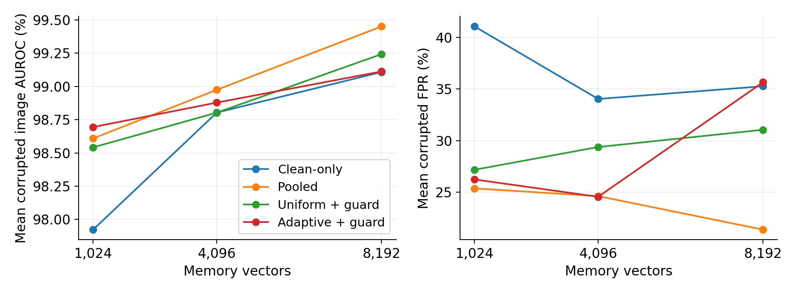
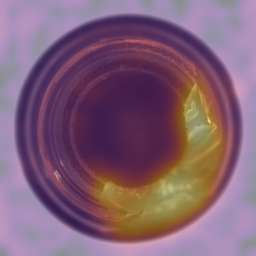

# Clean-Anchored PatchCore

Group 23, Deep Learning and Computer Vision, IIIT Sri City.

**Authors:** Sarthak Shukla (S20230020348) and Yash Doshi (S20230020360).

A controlled industrial anomaly-detection study: preserve clean feature anchors,
allocate remaining fixed memory to the weakest-covered acquisition group, and
validate clean coverage using normal images only.

**Completed and audited:** 27 category/seed/budget experiments, six methods and ten conditions each (1,620 metric rows).

[Final paper](group23-final-paper.pdf) · [Final report](group23-final-report.pdf) · [Full results](results/analysis/summary.csv)

At B=4,096, metrics below equally average categories, seeds and nine corrupted conditions.

| Method | Corrupted image AUROC | Pixel AP | FPR |
|---|---:|---:|---:|
| clean | 98.80% | 61.78% | 34.04% |
| pooled | 98.97% | 64.10% | 24.62% |
| uniform | 98.80% | 63.08% | 29.38% |
| adaptive | 98.88% | 63.15% | 24.55% |
| no_guard | 99.03% | 63.90% | 23.07% |
| no_anchor | 98.83% | 61.93% | 34.97% |

The primary adaptive-minus-pooled comparison using seed-averaged scores is **+0.05 percentage points**, 95% paired bootstrap interval **[-0.12, +0.23]**. The prespecified success criterion was **not met**. The table averages per-seed AUROCs; the primary test averages scores before computing AUROC. These different aggregation orders can produce differences with opposite signs. Negative findings are retained. The earlier midterm pilot is not pooled with the final study.



## Experiment design

| Setting | Value |
|---|---|
| Categories | MVTec AD bottle, hazelnut, tile |
| Seeds | 23, 42, 61 |
| Memory budgets | 1,024 / 4,096 / 8,192 vectors |
| Methods | Clean-only, pooled, uniform + guard, adaptive + guard, without guard, without anchors |
| Backbone | Frozen WideResNet-50-2, ImageNet V1, layer2/layer3 |
| Input / descriptor | 256 x 256 RGB / 1,024 float32 values |
| Fitting groups | Clean, brightness 0.85/1.15, JPEG quality 85 |
| Test conditions | Clean; brightness 0.75/0.60/0.45; JPEG 70/50/30; blur 0.5/1.0/1.5 |
| Threshold | Clean-normal calibration rank ceil(0.95(n+1)), fixed across conditions |
| Primary test | Adaptive vs pooled at B=4,096; paired, stratified image bootstrap with seed-averaged scores |

The proposal is tested as written, including negative findings. A high ranking
AUROC is not equivalent to low false-positive rates at a frozen threshold.
This is a three-category course project, not a full-benchmark reproduction.

## Reproduce

To verify the downloaded project and recompute numerical analysis without a GPU
or dataset images, install the numerical dependencies and run:

```powershell
python -m pip install numpy==2.4.6 scipy==1.16.0 scikit-learn==1.7.0 matplotlib==3.10.8 Pillow==11.2.1
python code/verify_published.py
python code/analyze_study.py
```

Verify checksums before rebuilding or modifying artifacts. Numeric analysis
retains the supplied qualitative figure when raw example maps are absent.

Use Python 3.12. The recorded environment uses PyTorch 2.7.1+cu118 and
TorchVision 0.22.1+cu118 on an RTX 2050 (4 GB), an Intel Core i5-12450H CPU,
and 15.68 GiB of OS-visible system RAM. See [hardware details](results/hardware.json).
Install the matching PyTorch build
for your hardware, then the remaining requirements. For the recorded CUDA build:

```powershell
python -m pip install torch==2.7.1 torchvision==0.22.1 --index-url https://download.pytorch.org/whl/cu118
python -m pip install -r code/requirements.txt
python -m unittest discover -s code -p test_core.py -v
python -u code/run_study.py --data data --cache reproduced_cache --results reproduced_results
python code/analyze_study.py --results reproduced_results
python code/audit_study.py --data data --results reproduced_results --pixels
python report/build_documents.py --results reproduced_results
```

The study runner downloads and verifies the three categories at a pinned mirror
revision. TorchVision downloads pretrained weights on first use. Allow several
hours on a laptop GPU and roughly 30 GB of working space. The runner checkpoints
each condition and skips complete runs. Core code/configuration changes are
rejected after the study lock; use a new results/cache directory for a different
protocol. The commands above use independent results/cache directories to preserve
the supplied experimental records. Rebuilding analysis and documents replaces
the generated figures and PDFs in the working copy.

The supplied `results/` records omit the full per-run banks, so use an independent output directory
when regenerating banks for prediction or a full pixel/bank audit.
Different GPUs or library builds can produce small floating-point differences;
the published checksums identify the supplied artifacts exactly.

For a local build, change into the `paper/` directory and compile `main.tex` with
pdfLaTeX, BibTeX, pdfLaTeX, pdfLaTeX, or Tectonic. The exported Overleaf ZIP is
flattened and uses its root-level `main.tex` as the main document. The supplied
CVPR 2026 style is unchanged. This format does not imply
conference acceptance or submission.

After reviewing the generated PDFs, run `python code/package_final.py` to export
the complete project ZIP and the flattened Overleaf ZIP into the sibling
`output/` folder. Published downloads are available on the
[v1.0.0 release page](https://github.com/sarthak06shukla/clean-anchored-patchcore/releases/tag/v1.0.0).

## Predict one image

Three reference adaptive banks (B=4,096, seed 23) are included in `models/`, one
for each category. They were chosen by the fixed reference seed, not by picking
the best test result. Install PyTorch/TorchVision as above, then run the supplied
bottle example without downloading the dataset:

```powershell
python code/predict.py --run models/bottle --image results/bottle_s23_b4096/examples/broken_large_clean.png --method adaptive --output prediction
```

Outputs are a JSON score/decision, raw anomaly map and PNG heatmap overlay.
Use the bank for the matching product category. Overlay normalization is for
display and is not a calibrated pixel segmentation threshold.

The supplied bottle example scores **2.4923** against a **1.5255** threshold and
is detected as anomalous. Its [recorded prediction](demo/prediction.json) matches
the archived study score exactly; [validation](demo/validation.json) is included.



## Repository contents

- `code/`: selectors, feature extraction, study runner, prediction, analysis and audit.
- `configs/`: locked study and per-run settings.
- `results/`: configuration identity, manifests, calibration, metrics and predictions.
- `results/analysis/`: aggregate, category/seed, failure, allocation and timing tables.
- `report/`: editable institutional report generator and data-derived figures.
- `paper/`: final paper source and supplied CVPR style/bibliography.
- `models/`: three ready-to-run reference adaptive banks and their calibration metadata.
- `demo/`: a checked single-image prediction, raw anomaly map and overlay.
- `data_provenance/`: pinned dataset revision, file hashes and dataset license.
- `milestones/`: historical preliminary and midterm reports, kept separate from final evidence.

Raw dataset images, backbone weights, caches, the remaining fitted banks and
patch-score grids are excluded from Git history. All banks/grids remain in the
local completed study; the runner regenerates them. Git alone supports checksum
and image-metric verification, numerical analysis and the three reference demos.
A complete bank/pixel audit requires the locally generated arrays.

## Scientific details

Each category's normal training images are split 60% fitting, 20% validation and
the remainder calibration, with integer floors for the first two partitions.
Test labels never select a bank, anchor fraction or threshold. Each group is
capped at 20,000 descriptors before exact deduplication. All methods share the
same candidates, backbone, precision and image-score reweighting (PatchCore
Eq. 7; nine neighbors including the nearest representative).

Uniform and adaptive compare anchor fractions 0.50 and 0.75 under a 10% clean
coverage tolerance. Without-guard retains anchors and normal-validation choice.
Without-anchors adaptively selects among all three groups and retains the guard.
All fallbacks and allocations are recorded. Fitted banks have equal payloads;
construction cost and total GPU memory need not be equal.

Pixel metrics pool all resized pixels within a condition. Corruption summaries
equally weight nine conditions, three categories and three seeds. The primary
bootstrap first averages each image's score over seeds, then resamples original
images within category and label while retaining all views and paired methods.
Its interval is conditional on these categories and fitted models.

The previously observed bottle pilot used unreweighted scoring and is excluded
from final tables. Final seeds and the nine-neighbor convention are recorded
before final evaluations; this is not claimed as a preregistered study.

## Attribution

- Roth et al., [Towards Total Recall in Industrial Anomaly Detection](https://arxiv.org/abs/2106.08265), CVPR 2022.
- [Amazon Science reference implementation](https://github.com/amazon-science/patchcore-inspection); design consulted, source not vendored.
- Bergmann et al., [MVTec AD](https://www.mvtec.com/research-teaching/datasets/mvtec-ad), CVPR 2019.
- [Pinned public dataset mirror](https://huggingface.co/datasets/foersben/mvtec-ad).

Original dataset imagery: MVTec Software GmbH, CC BY-NC-SA 4.0. Derived report
images include resizing, corruptions and heatmap overlays and retain that
license. See `data_provenance/dataset_license.txt` and `THIRD_PARTY_NOTICES.md`.
